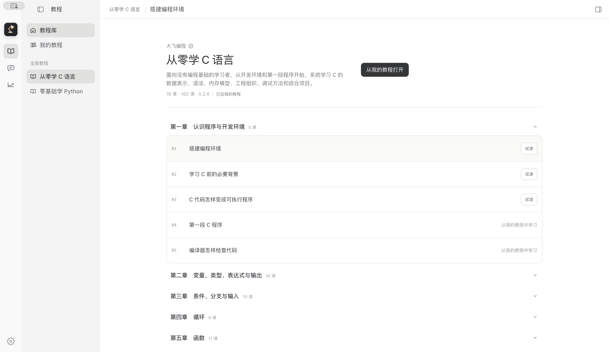
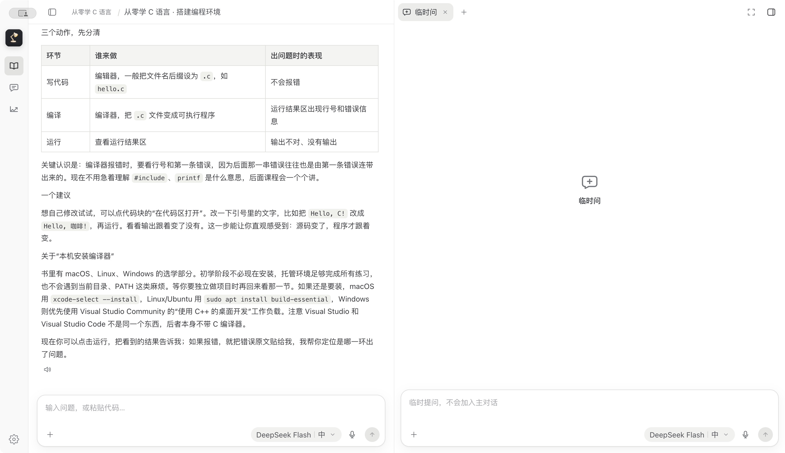
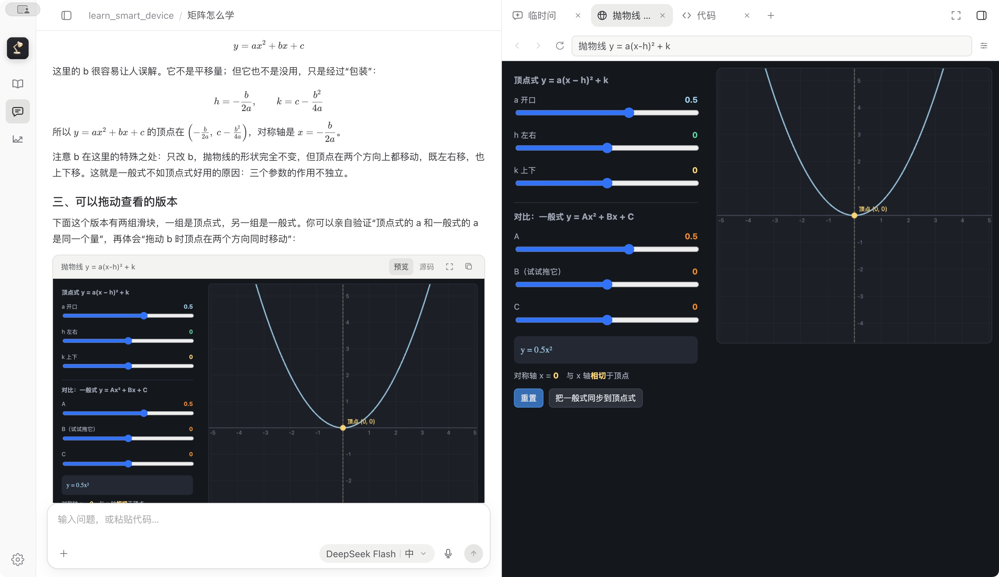
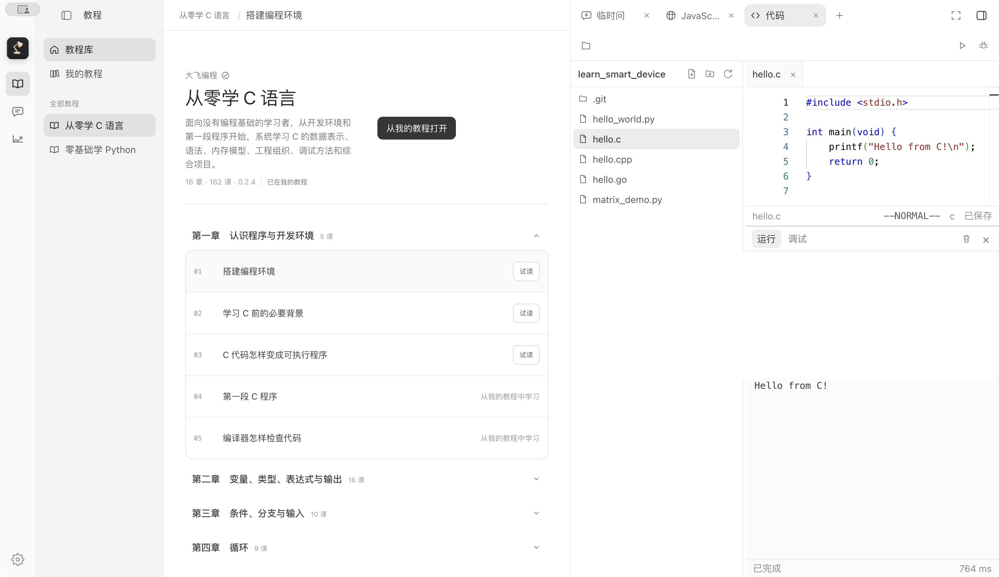
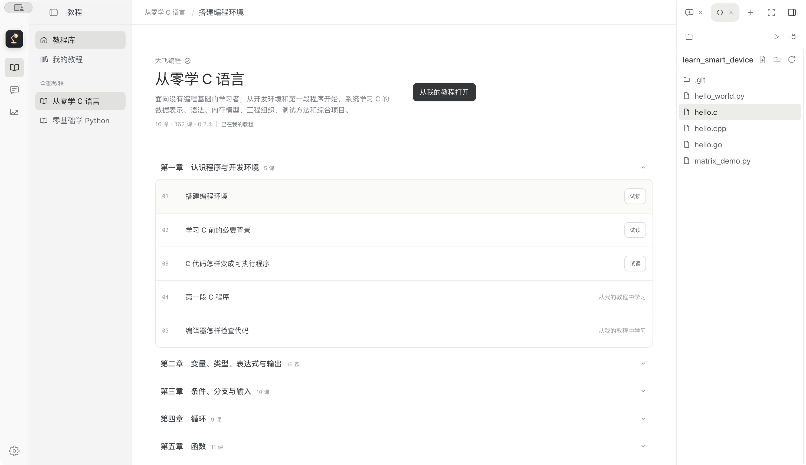
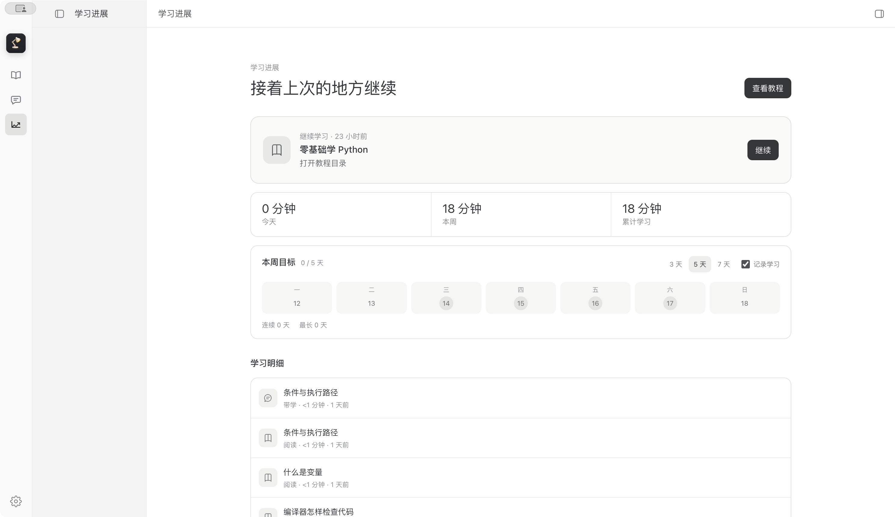

# 大飞学园

大飞学园是一款适合零基础学习编程的 AI 桌面应用。安装后即可编写、运行和调试程序，不必先研究复杂的开发环境；配置自己的大模型 API Key 后，就可以通过对话学习知识、完成练习，并在遇到问题时随时获得讲解。

除了内置教程，你还可以使用内置浏览器学习网上的教程和文章，或者直接打开本地文档、代码、PDF、图片和音视频资料。教程阅读、AI 对话、代码实践、网页学习和本地资料都在同一个工作空间中，无需在多个工具之间来回切换。

## 从安装到开始学习

1. 安装并打开大飞学园。
2. 在设置中配置大模型 API Key。
3. 选择教程开始学习，或打开网页、本地资料自由学习。
4. 直接在应用中编写并运行代码，遇到问题就继续提问。

## 产品截图

### 完整教程，按章节持续学习



### AI 带着学，讲解、提问和练习自然衔接



### 聊天中直接运行代码和交互内容



### 右栏代码工作区，边学边写、运行和调试



### C、C++、Python、Go 多语言项目



### 记录自己的学习进展



## 下载

- [下载 macOS Apple 芯片版](https://github.com/tongpengfei/dafei-academy/releases/download/v0.1.0/DaFeiAcademy-0.1.0-macOS-arm64.dmg)
- [下载 Windows x64 版](https://github.com/tongpengfei/dafei-academy/releases/download/v0.1.0/DaFeiAcademy-Setup-0.1.0-x64.exe)
- [查看全部版本](https://github.com/tongpengfei/dafei-academy/releases)

### macOS 首次打开

将应用拖入“应用程序”文件夹。如果系统提示应用已损坏，请打开“终端”，执行：

```bash
xattr -dr com.apple.quarantine /Applications/DaFeiAcademy.app
```

执行完成后重新打开应用。

## 主要功能

- 阅读教程，并通过对话继续提问和练习
- 安装后直接编写、运行和调试程序，减少开发环境带来的上手负担
- 配置大模型 API Key，使用 AI 讲解知识、分析问题并辅助练习
- 使用内置浏览器学习网上的教程和文章
- 打开本地文档、代码、PDF、图片和音视频资料继续学习
- 在网页、本地文件和教程中选中内容后随时提问
- 在聊天中直接运行代码和交互式 HTML 内容
- 在右侧工作区编写、运行和调试 C、C++、Python、Go 等语言
- 预览 Markdown、图片、音视频、PDF、HTML 等常用内容
- 在右侧工作区使用浏览器、文件、代码和临时问答，并按需放大
- 支持语音输入、文本朗读、数学公式和代码高亮
- 保存学习进展，帮助长期持续学习

## 支持平台

| 平台 | 状态 |
| --- | --- |
| macOS Apple 芯片 | 可用 |
| Windows x64 | 可用 |

## 隐私

本地项目和代码默认保留在设备中。只有在用户主动使用联网功能时，应用才会请求相应的在线服务。

## 当前阶段

项目仍在持续开发中，功能和界面会不断完善。

